<p align="center">
  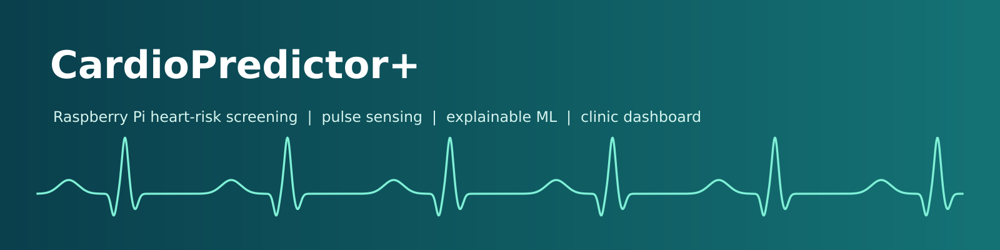
</p>

<p align="center">
  
  
  
  
  
  
  
</p>

<h3 align="center">A low-cost heart-risk screening station: register a patient, read the pulse from a fingertip sensor, get a 12-year cardiovascular risk estimate with a per-patient explanation, and keep everything in that patient's own folder.</h3>

> **Research prototype. Not a medical device.** Outputs are model estimates, not diagnoses. See [Limitations](#-limitations-and-honest-status).

---

## Demo

<p align="center">
  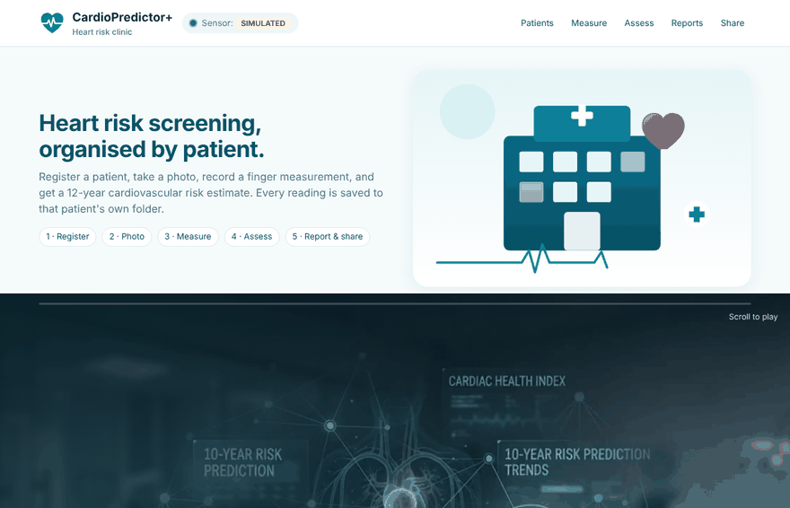<br>
  <sub>Dashboard walkthrough (synthetic demo patient, simulated pulse). Register, photo, finger measurement, risk assessment, reports and share link.</sub>
</p>

<p align="center">
  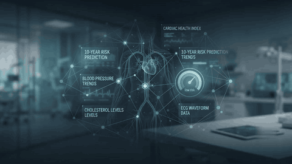
  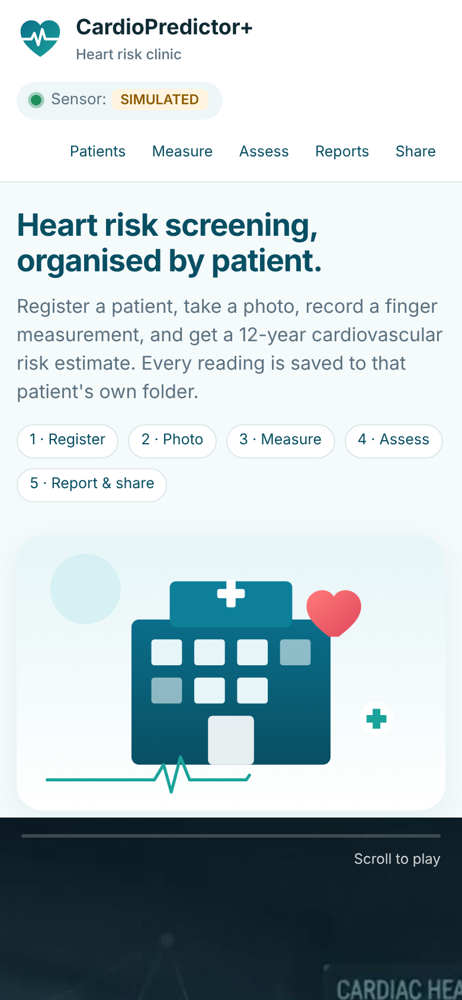
  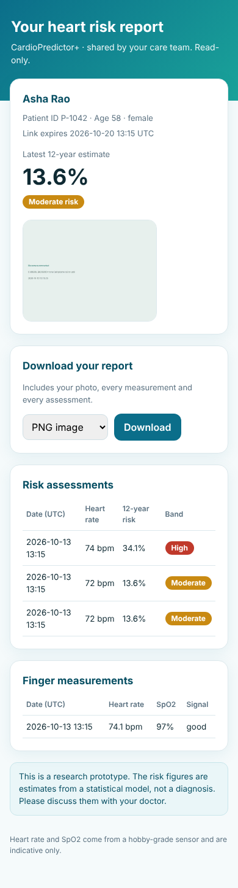<br>
  <sub>The intro plays as you scroll (full video: <a href="docs/media/intro-scroll-video.mp4">docs/media/intro-scroll-video.mp4</a>). The dashboard and the patient share page work on phones.</sub>
</p>

## Table of contents
[What it does](#-what-it-does) | [How it works](#-how-it-works) | [Architecture](#-architecture) | [Tools used](#-tools-used) | [Hardware](#-hardware) | [Quick start](#-quick-start) | [Model and results](#-model-and-results) | [API](#-api) | [Project layout](#-project-layout) | [Limitations](#-limitations-and-honest-status) | [Docs](#-more-documentation)

---

## What it does

| | |
|---|---|
| **Patient registry** | Every patient gets a folder (`data/patients/<id>/`) holding their details, photos, measurements, assessments and reports. |
| **Photo, three ways** | Raspberry Pi camera, a USB webcam, or any photo uploaded from a phone or laptop browser (the Pi can stay the server). |
| **Pulse sensing** | MAX30102 (heart rate and approximate SpO2) or HW-827 analog pulse sensor through an ADS1115 (heart rate only). With no sensor, the heart rate is typed in and recorded as *manual*. |
| **12-year risk** | Calibrated model trained on the Framingham data, with a plain-language list of the factors that raised or lowered *this* patient's risk. |
| **Reports** | PNG, TXT or DOCX from a dropdown. |
| **Share links** | Read-only page for the patient, with a random token that expires (1 to 30 days) and can be revoked. |
| **Runs everywhere** | 24/7 as a systemd service on a Raspberry Pi, or on a Mac/Linux laptop for development. Remote access over a private network (Tailscale). |
| **Honest by design** | The sensor chip says `MAX30102`, `HW-827`, `SIMULATED` or `NOT CONNECTED`. A simulated pulse is never passed off as a measurement. |

<p align="center">
  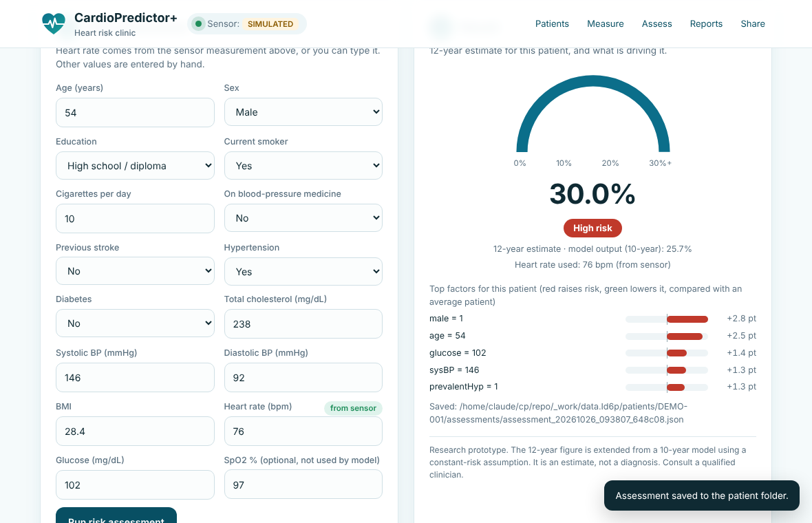<br>
  <sub>Result card: 12-year estimate on a gauge, the category, and the factors driving this patient's number.</sub>
</p>

## How it works

### Clinical workflow

```mermaid
flowchart LR
    A[1. Register patient] --> B[2. Photo<br/>Pi camera, phone or file]
    B --> C[3. Finger measurement<br/>MAX30102 or HW-827]
    C --> D[4. Enter clinical values<br/>BP, cholesterol, glucose ...]
    D --> E[5. Calibrated model<br/>10-year probability]
    E --> F[6. 12-year estimate<br/>+ per-patient explanation]
    F --> G[7. Saved to the<br/>patient folder]
    G --> H[8. Report PNG/TXT/DOCX<br/>+ share link]
    C -. no sensor .-> D
```

### What happens during a finger measurement

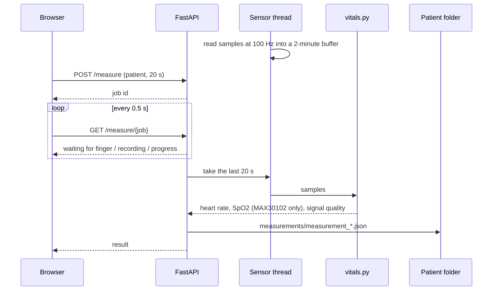

### How the risk number is produced

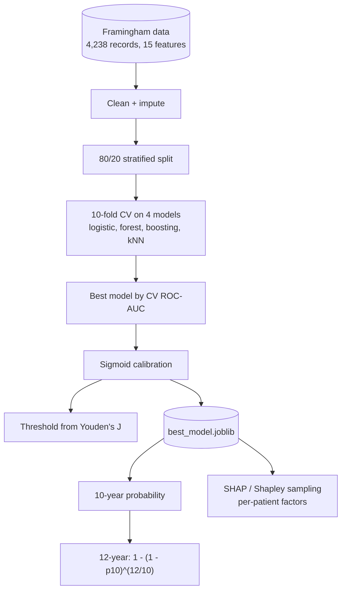

> The model predicts 10-year risk. The 12-year figure assumes a constant yearly hazard, so it is an **approximation**, not a separately trained 12-year model.

## Architecture

<p align="center">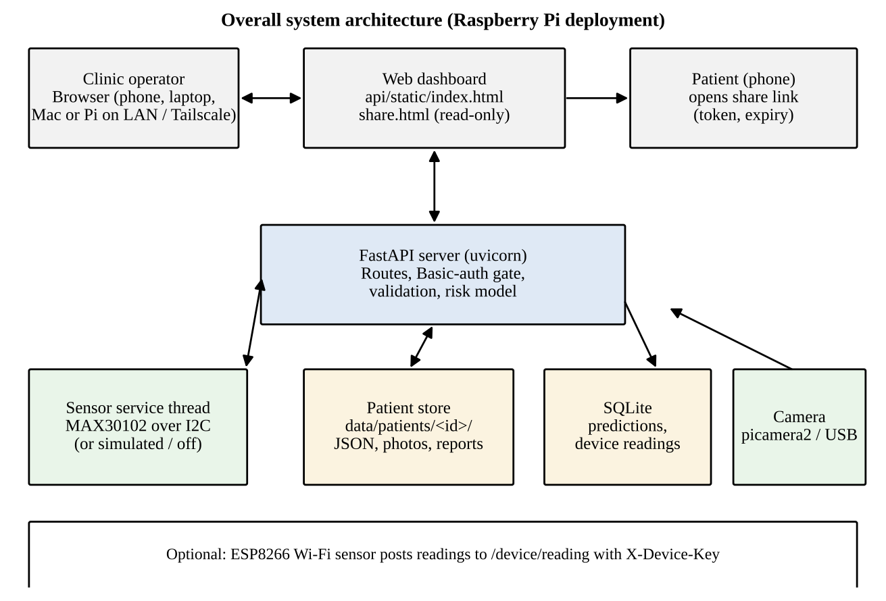</p>

<details>
<summary><b>Software layers</b></summary>
<p align="center">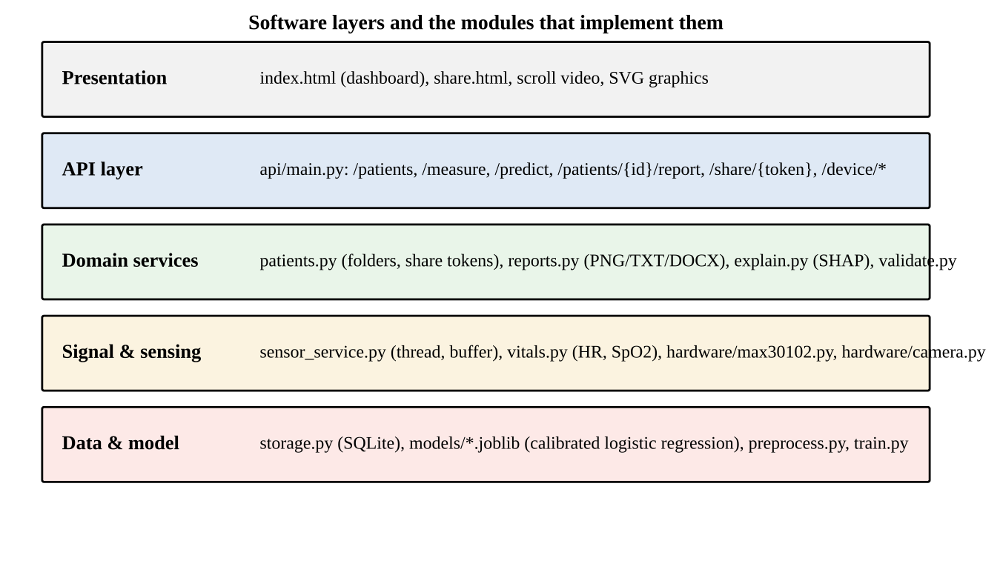</p>
</details>

<details>
<summary><b>Pulse signal processing</b> (real code on a simulated signal)</summary>
<p align="center">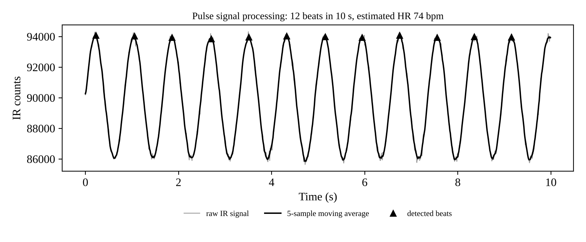</p>

Baseline removal (1 s moving average), light smoothing, peak detection with a refractory period, median beat interval to beats per minute, and an interval-variability score that grades the signal as good, fair or poor.
</details>

## Tools used

| Area | Tools |
|---|---|
| **Hardware** | Raspberry Pi 4 Model B (Pi 3 for testing), MAX30102 pulse oximeter, HW-827 pulse sensor + ADS1115 ADC, Pi Camera Module / USB webcam, optional ESP8266 sensor node |
| **Backend** | Python, FastAPI, Uvicorn, Pydantic v2, SQLite, smbus2 (I2C), picamera2 / OpenCV |
| **Machine learning** | scikit-learn (logistic regression, random forest, gradient boosting, kNN), XGBoost (optional), calibration (Platt), SHAP with Shapley-sampling fallback, pandas, NumPy, joblib |
| **Signal processing** | NumPy peak detection, ratio-of-ratios SpO2 |
| **Reports** | matplotlib (PNG), python-docx (DOCX), plain TXT, Pillow |
| **Frontend** | Single-page HTML/CSS/JavaScript, inline SVG, scroll-linked video, no framework |
| **Deployment** | systemd service, Raspberry Pi OS, Tailscale (private remote access), shell installer |
| **Quality** | pytest (58 tests), Playwright (headless browser checks), ffmpeg (video processing) |

## Hardware

| Part | Notes |
|---|---|
| Raspberry Pi 4 Model B, 4 GB | Main server (24/7). A Pi 3 also runs it for testing. |
| MAX30102 breakout | I2C `0x57`. Heart rate and approximate SpO2. |
| HW-827 + ADS1115 | Analog pulse sensor needs an ADC; the Pi has no analog inputs. Heart rate only. |
| Camera | Pi Camera Module (CSI), USB webcam, or none (upload from phone/laptop). |
| Power | Certified 5 V supply (3 A for Pi 4). |

<p align="center">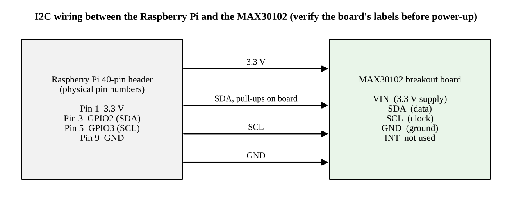</p>

**MAX30102:** VIN to pin 1 (3.3 V), SDA to pin 3, SCL to pin 5, GND to pin 9.

**HW-827 + ADS1115** (power everything from **3.3 V, never 5 V**):

```
HW-827  +  -> Pi pin 1 (3.3 V)      ADS1115 VDD  -> Pi pin 1
HW-827  -  -> Pi pin 6 (GND)        ADS1115 GND  -> Pi pin 6
HW-827  S  -> ADS1115 A0            ADS1115 SDA  -> Pi pin 3
                                    ADS1115 SCL  -> Pi pin 5
                                    ADS1115 ADDR -> GND  (address 0x48)
```

Choose the sensor with `SENSOR_MODE`: `auto` (default: MAX30102, then HW-827, then simulated), `max30102`, `hw827`, `simulate`, or `off` (manual heart rate).

## Quick start

### On a Mac or Linux laptop (no sensor needed)

```bash
git clone https://github.com/Lohithl27/CardioPredictor-Plus.git
cd CardioPredictor-Plus
bash run_mac.sh
```

Open **http://127.0.0.1:8000/dashboard/**. The sensor is off by default; type the heart rate by hand. Full guide: [docs/MACOS.md](docs/MACOS.md).

### On the Raspberry Pi

```bash
git clone https://github.com/Lohithl27/CardioPredictor-Plus.git
cd CardioPredictor-Plus
bash deploy/install_rpi.sh      # packages, I2C, venv, model, service, random password
sudo reboot
```

Then open `http://<pi-ip>:8000/dashboard/` (find the address with `hostname -I`). The installer prints a dashboard password; it is stored in `/etc/cardiopredictor.env`. Check the sensor with `i2cdetect -y 1` and the service with `sudo systemctl status cardiopredictor`.

Step by step (with remote access from other laptops and phones): [docs/RASPBERRY_PI_DEPLOYMENT_GUIDE.pdf](docs/RASPBERRY_PI_DEPLOYMENT_GUIDE.pdf).

### Run the tests

```bash
source .venv/bin/activate
python -m pytest -q tests
```

## Model and results

Trained on 4,238 Framingham records with 15 risk factors, 80/20 stratified split, model chosen by 10-fold cross-validated ROC-AUC.

| Model | CV ROC-AUC (mean) | Test ROC-AUC | Recall @0.5 | Brier |
|---|---|---|---|---|
| **Logistic regression (selected)** | 0.731 | 0.700 | 0.605 | 0.211 |
| Random forest | 0.717 | 0.669 | 0.481 | 0.189 |
| Gradient boosting | 0.710 | 0.667 | 0.070 | 0.127 |
| k-nearest neighbours | 0.684 | 0.657 | 0.023 | 0.126 |

After calibration the selected model's Brier score fell from 0.211 to 0.121. The decision threshold (0.143) maximises Youden's J; at that threshold recall is 0.63. A test ROC-AUC near 0.70 is modest and honest for this dataset: use it to rank patients, not to diagnose.

<p align="center">
  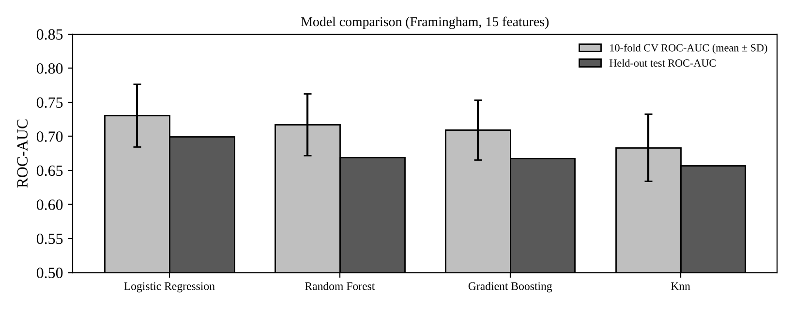
  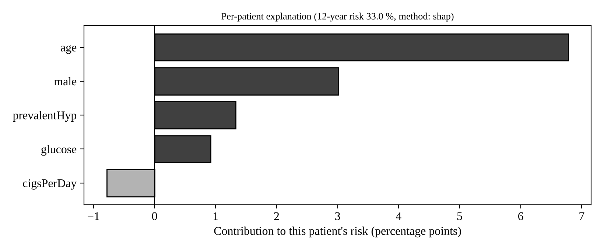
</p>

## API

Interactive docs at `/docs` when the server runs.

| Endpoint | Purpose |
|---|---|
| `POST /patients`, `PUT /patients/{id}`, `GET /patients` | Register, edit, list |
| `POST /patients/{id}/photo` / `/photo/capture` | Upload any image / capture with the Pi camera |
| `GET /sensor/live`, `POST /measure`, `GET /measure/{job}` | Live reading and timed measurement |
| `POST /predict` | 12-year risk with per-patient factors |
| `GET /patients/{id}/report?format=png\|txt\|docx` | Reports |
| `POST/DELETE /patients/{id}/share`, `GET /share/{token}` | Expiring read-only links |
| `GET /history/{id}`, `/trend/{id}` | Risk history and direction |
| `GET /health` | Status, sensor source, data-folder check |

When `CARDIO_DASHBOARD_PASSWORD` is set, everything except share links, device endpoints and `/health` needs the password.

## Project layout

```
CardioPredictor-Plus/
  api/                  FastAPI app + dashboard (static/index.html, share.html)
  src/                  train, preprocess, validate, explain, storage, patients, reports,
                        sensor_service, vitals, hardware/{max30102,hw827,camera}.py
  models/               trained model, threshold, comparison results
  data/framingham.csv   training data
  deploy/               install_rpi.sh, cardio.service
  firmware/             optional ESP8266 sensor node (not yet compiled or tested)
  tests/                pytest suite
  docs/                 guides, images, media
  run_mac.sh            one-command start on macOS/Linux
```

## Limitations and honest status

| Item | Status |
|---|---|
| Risk model, API, reports, share links, dashboard | Tested (58 automated tests, browser checks) |
| Pulse estimation | Tested on synthetic signals with known heart rates |
| MAX30102 driver, HW-827 + ADS1115 reading, Pi camera capture | Written, **not yet verified on real hardware** |
| Pulse / SpO2 accuracy against a clinical device | **Not validated** |
| Systemd installer on a Pi, Tailscale access | Written, being tested on a real Pi |
| ESP8266 firmware | Written, not compiled or flashed |

- The model is trained on one (largely European-ancestry, US) cohort. It is **not validated for other populations**.
- The 12-year figure is a constant-hazard approximation of a 10-year model.
- Missing values are imputed on the whole dataset before the train/test split (a small leak, to be moved inside the cross-validation pipeline).
- SpO2 from a fingertip hobby sensor is indicative only and never feeds the risk model.
- The server speaks plain HTTP: use it on a private network (Tailscale or LAN), not the open internet.

## More documentation

- [macOS guide](docs/MACOS.md) and [Raspberry Pi guide (PDF)](docs/RASPBERRY_PI_DEPLOYMENT_GUIDE.pdf) / [(Word)](docs/RASPBERRY_PI_DEPLOYMENT_GUIDE.docx)
- [v6 update notes: HW-827 wiring, phone photos, troubleshooting](docs/UPDATE_NOTES_v6.md)
- [deploy/RASPBERRY_PI_GUIDE.md](deploy/RASPBERRY_PI_GUIDE.md)

## Acknowledgements

Framingham Heart Study investigators; the scikit-learn, SHAP, FastAPI and Raspberry Pi communities.

## License

MIT, see [LICENSE](LICENSE). The Framingham data file is included for reproducibility; check its original terms before redistributing it elsewhere.
